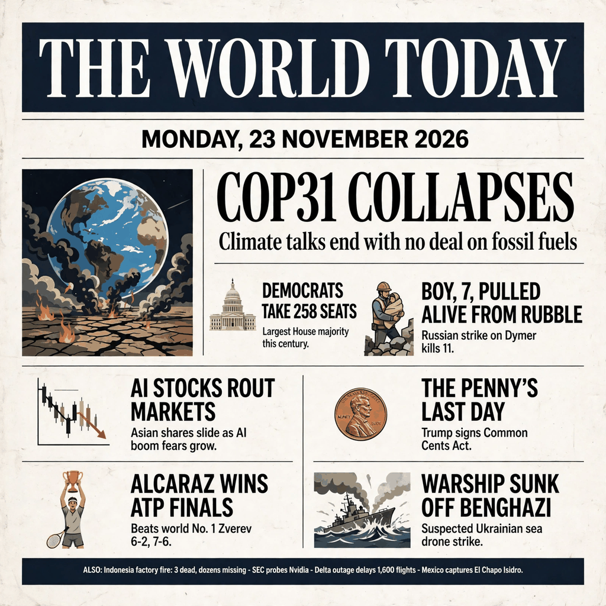

[](https://make.fun/bounty/news-image-20261123?utm_source=github&utm_medium=readme&utm_campaign=news-image-20261123)
[](https://make.fun/bounty/news-image-20261123/leaderboard?utm_source=github&utm_medium=readme&utm_campaign=news-image-20261123)
[](https://make.fun/bounty/news-image-20261123?utm_source=github&utm_medium=readme&utm_campaign=news-image-20261123)

# The World Today — Monday, 23 November 2026

A front-page poster summing up the world's news of **Monday, 23 November 2026**,
built for the [make.fun bounty](https://make.fun/bounty/news-image-20261123).



## The day in six stories

1. **COP31 COLLAPSES** — The UN climate talks in Antalya end with no deal on
   fossil fuels, the longest climate summit on record closing empty-handed.
2. **DEMOCRATS TAKE 258 SEATS** — Democrats clinch at least 258 House seats in
   the US midterms, their largest House majority this century.
3. **BOY, 7, PULLED ALIVE FROM RUBBLE** — Rescuers free 7-year-old Davyd after
   14 hours under a collapsed block of flats in Dymer, Kyiv region, after an
   overnight Russian strike that killed 11.
4. **AI STOCKS ROUT MARKETS** — Asian shares slide as fears grow that the AI
   investment boom is losing momentum; regulators step in to calm markets.
5. **THE PENNY'S LAST DAY** — President Trump signs the Common Cents Act,
   ending the US penny's 232-year run.
6. **ALCARAZ WINS ATP FINALS** — Carlos Alcaraz beats world No. 1 Alexander
   Zverev 6–2, 7–6 in Turin for his first ATP Finals title.

Also in the footer strip: a Russian warship sunk off Benghazi in a suspected
Ukrainian sea-drone strike, Belgium's airports shut by a nationwide strike, the
Indonesia candy-factory fire (3 dead, dozens missing), the SEC probing Nvidia,
a Delta outage delaying 1,600 flights, and Mexico's capture of "El Chapo Isidro".

Sources for every story are listed in [RESEARCH.md](RESEARCH.md).

## How it works

`main.ts` (Node 22, standard library only, no network) copies `entry.png` to
`$MAKEFUN_OUTPUT_DIR/entry.png` (default `./out`) after a strict self-check
gate: PNG signature, size at most 1 MiB, dimensions at most 1024×1024, every
PNG chunk's CRC verified, and the file ending cleanly at IEND. Two runs write
byte-identical output.

```sh
mkdir -p out && MAKEFUN_OUTPUT_DIR=out node main.ts
```

## License

MIT — see [LICENSE](LICENSE).
